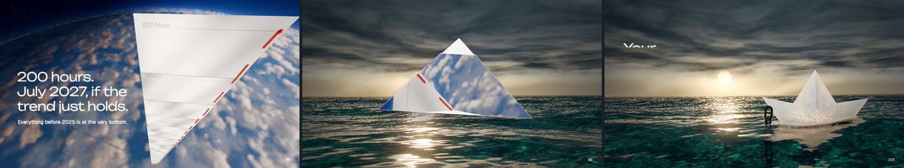

# Claude Artifact 动画拆解 · The Last Boring Slide

一张图表如何折成海上的纸船？这个仓库逐拍拆解 @fluxxrider 的交互演讲：讲者按下一个键，哪层画面先动，相机往哪里走，声音又在哪一刻响起。[原作出处](https://claude.ai/artifact/Cy2d8Vn63CnzCtonA1LSah)



*同一次转场的三个时刻 · 0.00 秒 / 1.58 秒 / 3.33 秒*

**13 个场景 · 43 个演讲节拍 · 129 幅起中末取样 · 10 种转场**

[逐场制作手册](scenes/README.md)　·　[高清图解](gallery.md)　·　[Agent 场景地图 JSON](evidence/deck-map.json)

## 看懂这张纸，能拆到多细？

**先看它怎样折。** 高塔离场时，程序把前一幕的图表画在纸面上。两组折痕分别在 0.80 秒和 0.90 秒启动，顶部和底部稍后跟进。最终，纸面与近、远两层阴影一起合成到海面上，完成这次 3.4 秒的交接。[转场实现](technical-notes.md)

**再看它怎样发声。** 到了纸船一场的最后一拍，讲者选中并删除锚链。以删除为零点，断裂声晚 0.04 秒，低频撞击晚 0.30 秒，第一阵水声晚 0.34 秒。船挣脱后，1.80 秒处还有一次音高更低的余波。这些偏移来自作品里的事件代码。[纸船的三拍与声音时序](scenes/boat.md)

**最后对照工具看到了什么。** 把折纸过程渲染成连续样片后，rea-video 在约 0.58 秒处检出了切点。当时白色纸面已经遮住大半视野，程序却仍在推进同一个转场。仓库同时提供样片、检测输出和代码依据，可以逐项复查。[动态实验](experiments.md) · [检测数据](evidence/motion-analysis.json)

## 按你想弄清的问题读

| 你想弄清什么 | 从哪里开始 |
| --- | --- |
| 一场演讲怎样从普通标题页走到最后一个问题？ | [13 场叙事拆解](breakdown.md) · [逐场画面](gallery.md) |
| 怎样让骨牌越倒越大，让海湾分界线可以拖动？ | [骨牌的尺度与落音](scenes/dominoes.md) · [海湾的双视图与手势](scenes/futures.md) |
| 讲者提前按键、退一拍或跳场时，动画怎样衔接？ | [播放器、转场与渲染预算](technical-notes.md) |
| 能否定位到同一拍，重新渲染并核对画面？ | [取样方法与实验记录](experiments.md) · [Python 取样脚本](analysis/sample_beats.py) |

## 让 Agent 从一场开始

场景地图把每一拍的**动作摘要、启动延迟、动画时长、自动停留时间、三帧取样位置**和对应笔记连在一起。要做相近的效果，可以直接把下面这段和仓库链接交给 Agent。[场景地图](evidence/deck-map.json) · [43 拍时序 CSV](evidence/beats.csv)

> 读这个仓库的场景地图，找到 futures。结合逐场笔记和取样图，解释两套画面如何共享视点、按分界线裁剪，以及为什么松开鼠标时不会误翻页。然后用两个简单场景做一个可拖动的最小示例。

<details>
<summary>查看 rea-video 的原始索引片与复跑命令</summary>

13 秒索引片从每场各取一帧，每帧停留一秒。它用于核对场景覆盖。要研究实际运动，请查看另外五段连续动作样片。[索引片](evidence/scene-samples.mp4) · [分镜输出](evidence/storyboard.jpg) · [检测结果](evidence/shot-results.json) · [连续样片实验](experiments.md)

```sh
rea-video decompose evidence/scene-samples.mp4 -o out/samples --no-vlm --no-asr --no-packaging --no-ocr --no-stems --no-moments --lang zh
```

[rea-video 工具仓库](https://github.com/JuneYaooo/rea-video)

</details>
