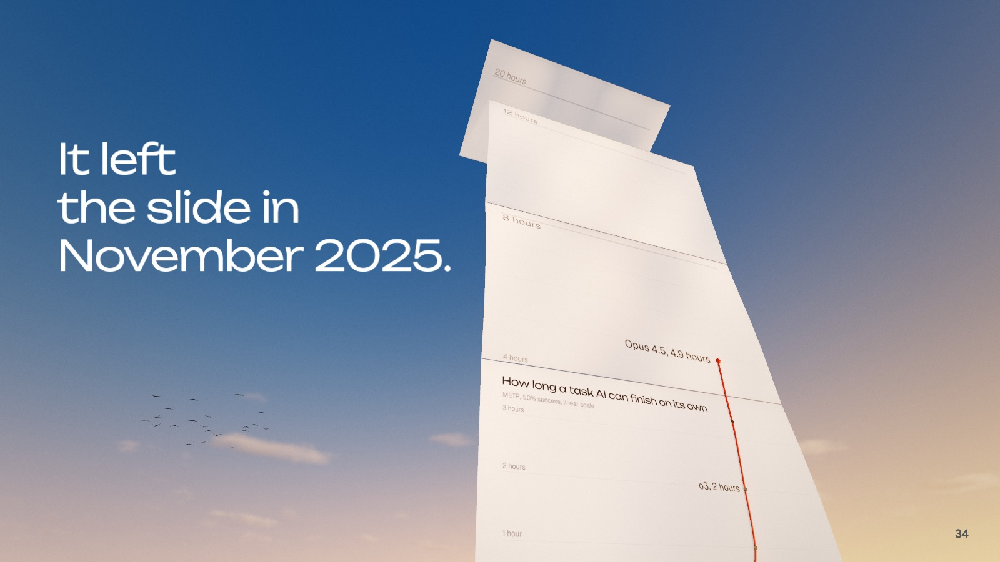

# Claude Artifact 动画演示拆解 · The Last Boring Slide

一个白底标题页，怎样变成一场可以走进图表、拖动两种未来、最后又回到白底标题页的演讲？这里收录了 @fluxxrider 的 Claude Artifact《The Last Boring Slide》的中文制作拆解，包含场景取样、检测结果和逐拍记录。[观看原作](https://claude.ai/artifact/Cy2d8Vn63CnzCtonA1LSah)

## 从图表走进高塔



**第二场 · The real chart**　原本挤在图表底部的数值，被放到一座塔的垂直尺度上。讲者继续推进时，视点随之升高，观众能直观看到数据之间的距离。

[逐场看完整演示画面：13 张大图与中文解读](gallery.md)

## 制作资料

- **演讲结构与叙事**。逐场查看 13 个场景的论点、画面和入场方式。纸船与锚链解释认知锚定，靶心把一度偏差放大成可见的落点距离，结尾再用一次按键改变观众对标题页的理解。[中文拆解](breakdown.md)
- **43 个演讲节拍**。CSV 每行对应一次可独立推进的状态，列出场景、入场方式、启动延迟、动画时长、自动播放停留时长和屏显页码。时间单位为秒，来自公开演示程序的配置；现场讲者可自行停顿。[逐拍数据](evidence/beats.csv)
- **画面取样与工具输出**。从本地实际渲染的每个场景取第二个节拍的一帧，按原顺序各停留一秒，得到 13 秒无声索引片。rea-video 检出 13 段。JSON 摘录了工具的切点、分数与像素分类；其中的静帧判断描述的是索引片。[分析输入 MP4](evidence/scene-samples.mp4) · [检测结果 JSON](evidence/shot-results.json) · [原始检测分镜图](evidence/storyboard.jpg)

## 怎样复查

在原作中按 O 打开场景总览，选中场景后用方向键推进，按 N 对照讲者备注。渲染引擎、转场和音效触发来自公开作品代码。声音部分核对了事件绑定，未做整场听审。复跑取样片的检测可使用 [rea-video](https://github.com/JuneYaooo/rea-video)：

```sh
rea-video decompose evidence/scene-samples.mp4 -o out/samples --no-vlm --no-asr --no-packaging --no-ocr --no-stems --no-moments --lang zh
```
