# 逐场看《The Last Boring Slide》

每场选取一个演讲状态重新渲染，画幅为 1600 × 900。图下说明描述整场如何推进；点开图片可看原尺寸。

## 01　一张普通的幻灯片

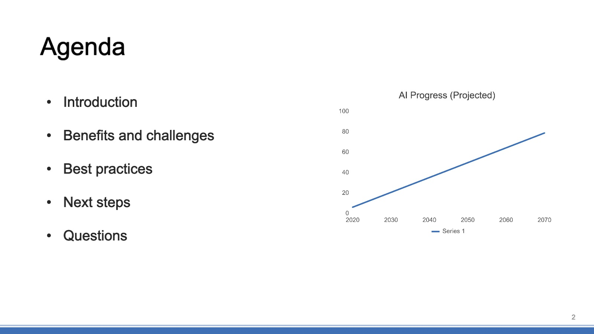

**The Future of AI** · 3 个演讲节拍 · 淡入

白底、黑色标题、灰色副标题和页脚蓝线建立普通 PPT 的预期，再用字体和版式突变打破它。

## 02　图表变成高塔

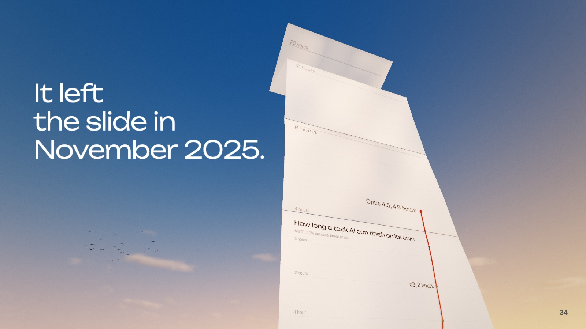

**The real chart** · 4 个演讲节拍 · 穿入

把能力增长画在一座高塔上。观众随视点升高，原本挤在图表底部的差距变成垂直距离。

## 03　纸船与锚链

**Anchor** · 3 个演讲节拍 · 折叠入场

海面、纸船与锚链把认知上的“锚定”变成可见的约束。

## 04　递归的画面

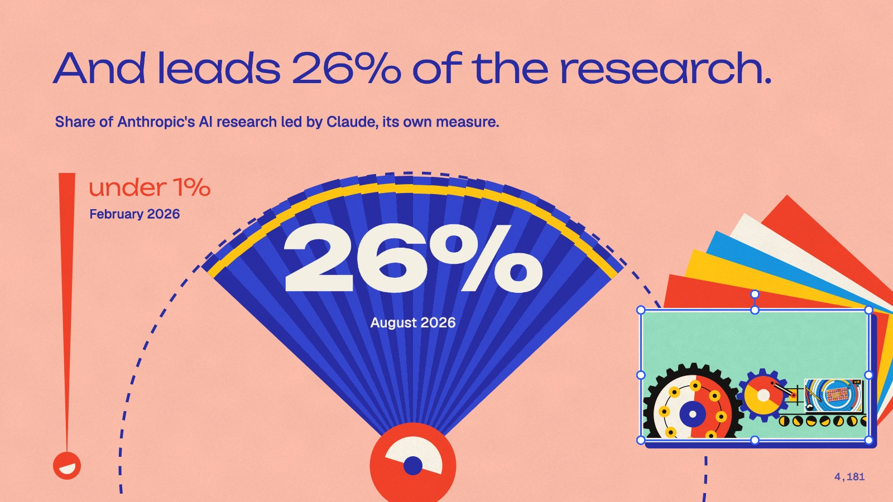

**The loop** · 4 个演讲节拍 · 冲洗式转场入场

图案嵌套在图案中，用递归构图讲“下一代参与制造下一代”。

## 05　从一个到一群

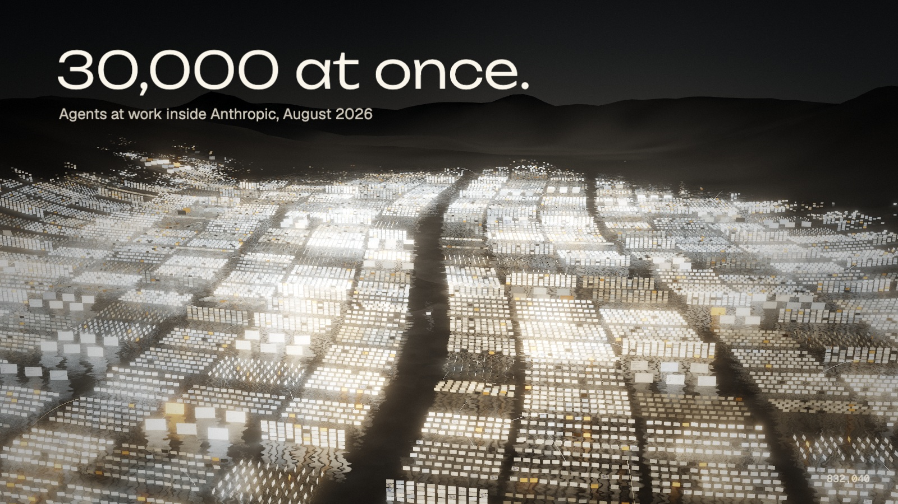

**A country of them** · 4 个演讲节拍 · 穿入

从单个工作者扩展到大量并行个体，画面尺度和数字一起升级。

## 06　放大的骨牌

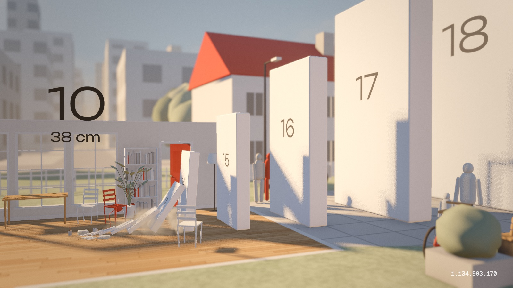

**Thirty steps** · 3 个演讲节拍 · 翻片入场

以多米诺骨牌的尺寸递增表现复利，末端巨牌与城市形成尺度对照。

## 07　变形的日历

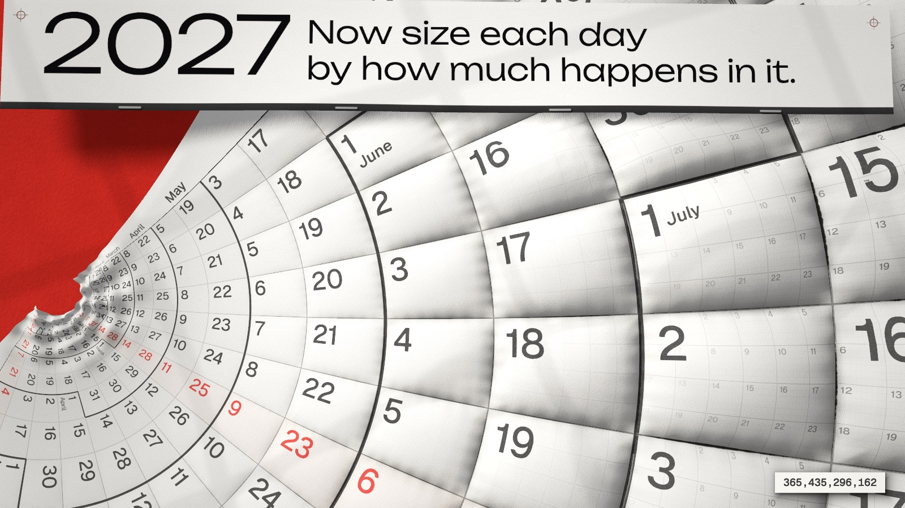

**2027** · 4 个演讲节拍 · 撞入

从平常的日历开始，再让日期占据的面积随事件密度变化。

## 08　灯光照得到哪里

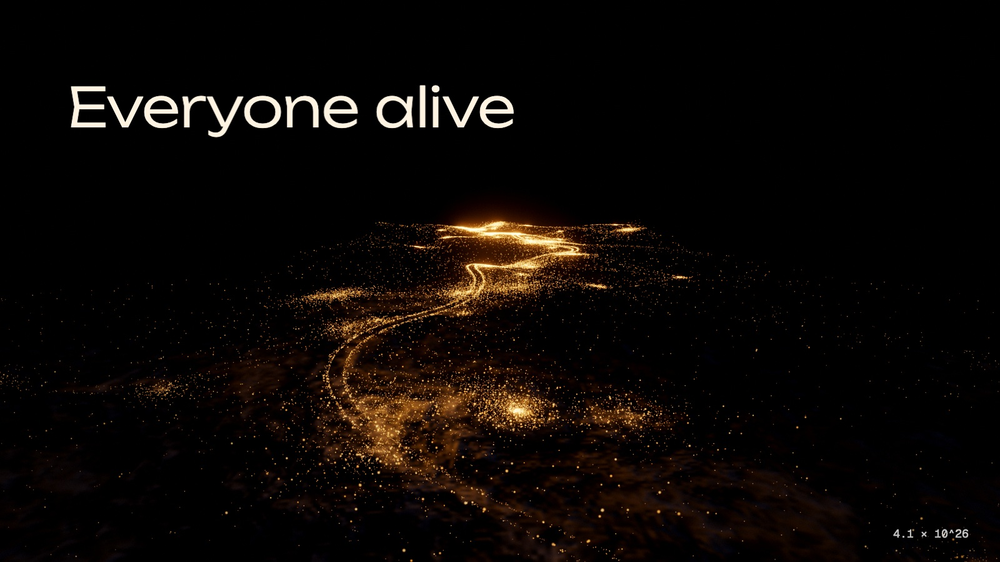

**How far you can see** · 3 个演讲节拍 · 穿出入场

借灯照到的范围解释能力边界，逐步扩大观众能看见的空间。

## 09　全选地球

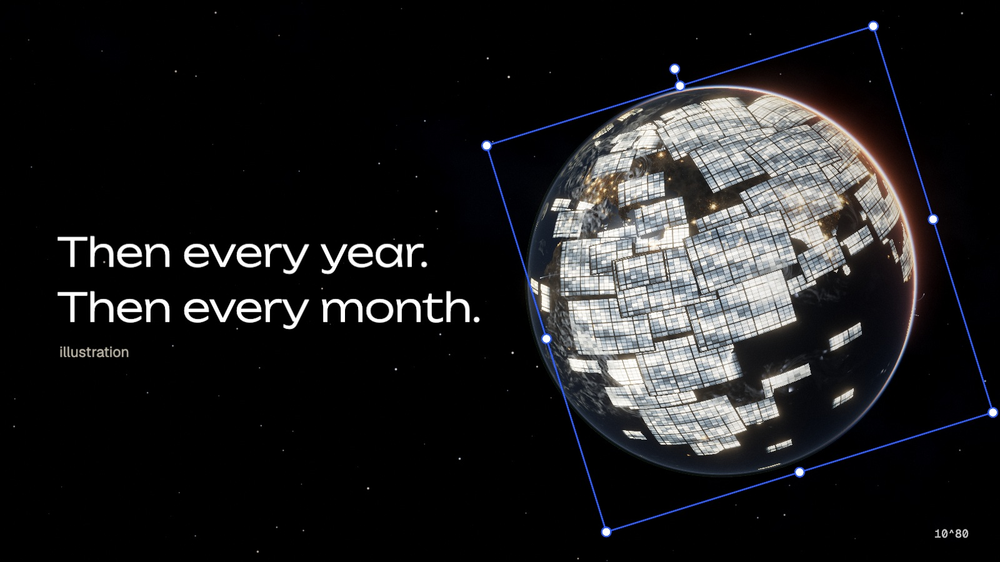

**Select all** · 3 个演讲节拍 · 天光显现入场

把软件里的“全选”移到地球尺度，衔接从屏幕操作到物理世界的论点。

## 10　偏离靶心的一度

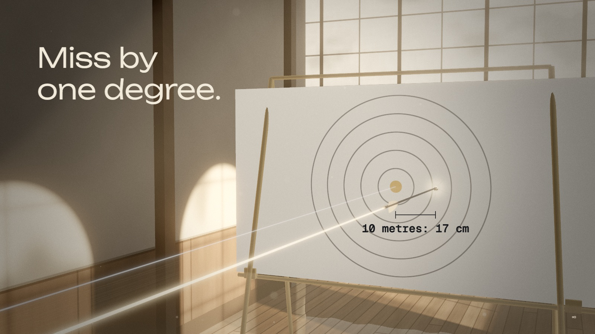

**Aim** · 4 个演讲节拍 · 线条转场入场

用靶心演示方向偏一度，目标越远，落点误差越大。

## 11　同一海湾的两种未来

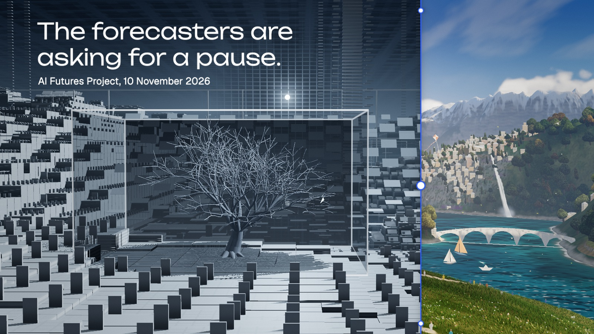

**Two aims** · 3 个演讲节拍 · 撕开入场

同一海湾呈现两种未来。拖动分界线可以直接比较两侧，录成视频时需要主动演示这个动作。

## 12　回到增长曲线的底部

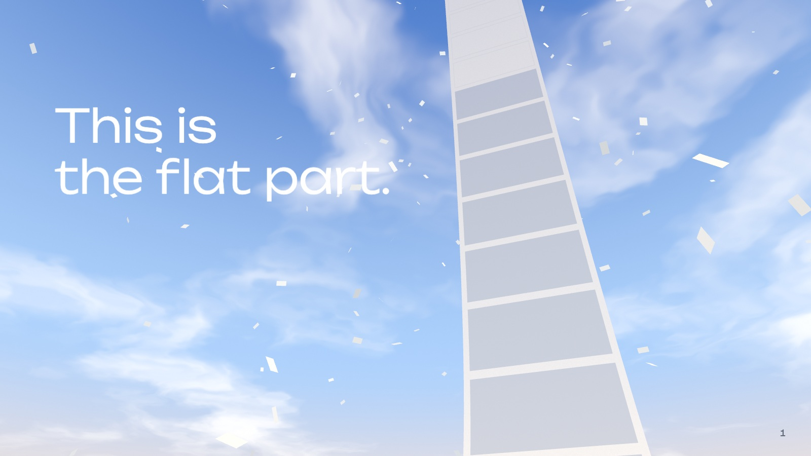

**You are here** · 2 个演讲节拍 · 穿入

此前的画面成为高墙上的一层层页面。视点回到底部，说明身在曲线起点时为何觉得它平坦。

## 13　最后一个问题

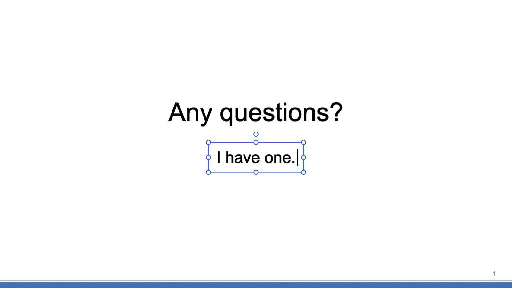

**Any questions?** · 3 个演讲节拍 · 穿出入场

回到开场的白底版式。等观众以为结束，再推进到“What do you want?”。停顿本身就是这个收尾的一部分。
