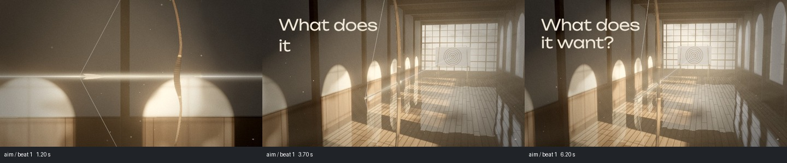
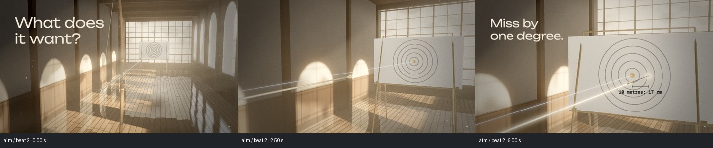
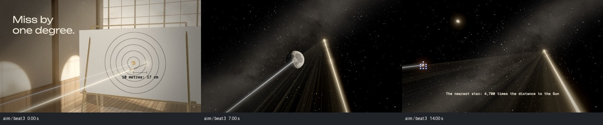
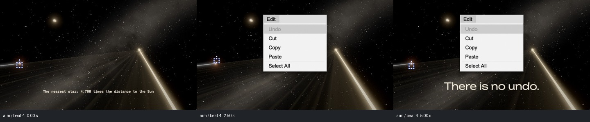

# 10 · 保持角度不变，只增加观察距离

原场景 **Aim** · 标识 `aim` · 4 拍。

## 画面是怎样搭起来的

靶场使用透视相机和三维物体；纸张单独用噪声着色生成。后处理可取世界点投影到屏幕的位置作为效果中心。远距离段用不同的尺度表达，字幕和刻度在独立叠层绘制。

## 动作怎样推进

叙事量可以直接写成 lateral = distance × tan(1°)。第二拍在近距离让人几乎忽略误差，第三拍用整整 14 秒把观察尺度拉远。靶心仍是观众追踪的方向参照。

## 复刻时怎样检查

用两个距离代入同一公式验证标签，例如 10 米约偏 0.175 米。保持角度不动，否则演示同时改变两个变量，观众就无法归因。

在公开发布包中先搜索场景标识 `id:"aim"`，场景内部可用这些词定位：`Miss by`、`uOff`、`uK`、`halation`。

## 逐拍取样

每行图从左至右是配置延迟结束、动画中点、动画终点。底部时间从本拍进入时起算；这些是定位渲染，现场讲者可以继续停留。

### 第 1 拍

用指向目标的射线引出方向问题。

延迟 1.2 秒 · 动画 5 秒 · 自动停留 3 秒。

### 第 2 拍

近距离观察一度偏差。

延迟 0 秒 · 动画 5 秒 · 自动停留 3.5 秒。

### 第 3 拍

固定角度、拉长距离，用几何关系放大误差。

延迟 0 秒 · 动画 14 秒 · 自动停留 3.5 秒。

### 第 4 拍

停在远端后果，让观众理解纠正机会的重要性。

延迟 0 秒 · 动画 5 秒 · 自动停留 5 秒。

[返回逐场目录](README.md) · [机器可读场景地图](../evidence/deck-map.json)
