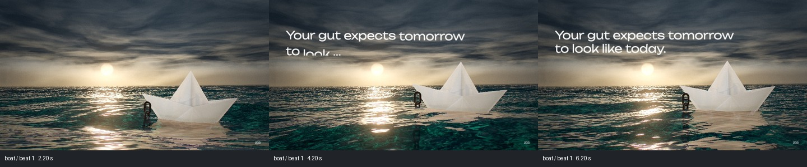
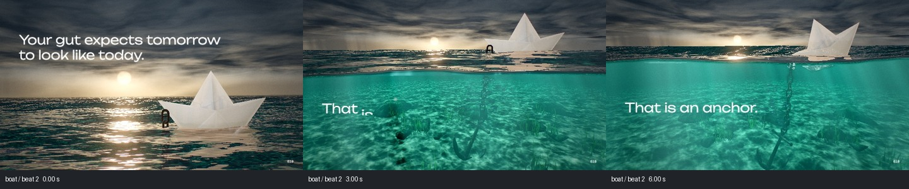
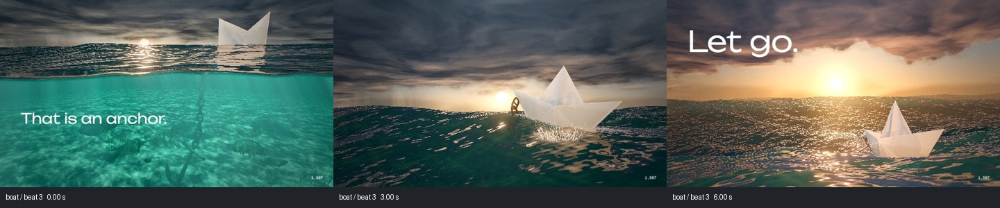

# 03 · 用张力、断点和水面反馈串起一个因果动作

原场景 **Anchor** · 标识 `boat` · 3 拍。

## 画面是怎样搭起来的

船体变换、链段位置和海面高度分别更新。程序把船体上的三个局部点投影到屏幕，由两端点的距离和夹角计算船的屏幕尺寸和朝向。断链后，两侧链段可以分别定位；船首、水面冲刷、气泡等效果使用不同的位置与时间参数。

## 动作怎样推进

末拍以选中链段开始。删除时触发 delete，随后 0.04 秒触发 snap、0.30 秒触发 boom、0.34 秒触发 wave、1.80 秒再触发较低音高的 wave。持续水声与张力另由状态参数调节。

## 复刻时怎样检查

将水位、船位和断点分别画成调试标记。释放前，链条应把船与同一处水面联系起来；释放后，水花与余波仍在事发位置出现。

在公开发布包中先搜索场景标识 `id:"boat"`，场景内部可用这些词定位：`uBoatS`、`uFoam`、`anchor`、`delete`。

## 逐拍取样

每行图从左至右是配置延迟结束、动画中点、动画终点。底部时间从本拍进入时起算；这些是定位渲染，现场讲者可以继续停留。

### 第 1 拍

让纸船浮在平静水面，建立参照。

延迟 2.2 秒 · 动画 4 秒 · 自动停留 2.5 秒。

### 第 2 拍

海面升高而链长保持，船被拉低。

延迟 0 秒 · 动画 6 秒 · 自动停留 3.5 秒。

### 第 3 拍

释放锚链，让“放下原先参照”有一个可见动作。

延迟 0 秒 · 动画 6 秒 · 自动停留 5 秒。

[返回逐场目录](README.md) · [机器可读场景地图](../evidence/deck-map.json)
