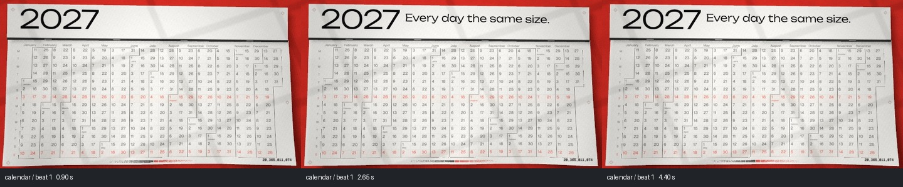
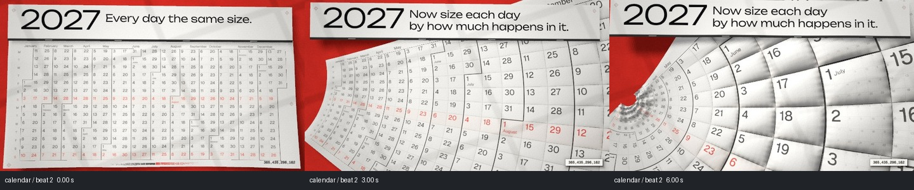
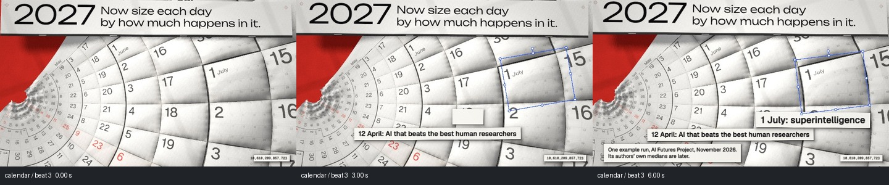
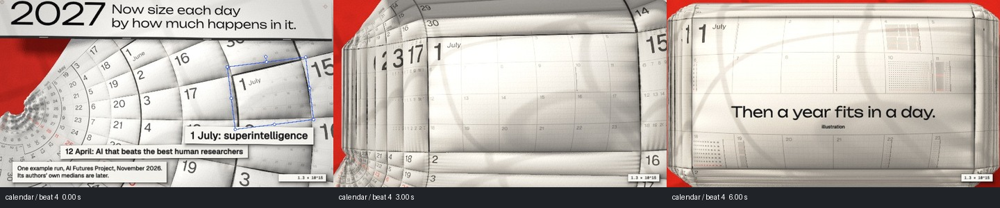

# 07 · 让日期格变形后仍然可读

原场景 **2027** · 标识 `calendar` · 4 拍。

## 画面是怎样搭起来的

日历向着色器提供查找纹理，其中一张为 27×14；透视视图负责可见画面，另一个正交视图用于 2048×1448 的深度渲染。弯曲、呼吸和震动分别由参数控制。

## 动作怎样推进

第二拍进度跨过 5% 触发纸声、45% 触发吱响；第三拍在 4% 和 46% 附近触发选择和断响。最后一拍在 3.2～4.4 秒间推进 uRow；颗粒和暗角在后处理阶段加入。

## 复刻时怎样检查

先确保普通网格上各日期可读，再对照变形后的重点日期。正文里的日期与增速是作品的模型情景，讲者备注应保留这一性质。

在公开发布包中先搜索场景标识 `id:"calendar"`，场景内部可用这些词定位：`uLut`、`uFish`、`uRow`、`uPuff`。

## 逐拍取样

每行图从左至右是配置延迟结束、动画中点、动画终点。底部时间从本拍进入时起算；这些是定位渲染，现场讲者可以继续停留。

### 第 1 拍

从等面积日期格出发。

延迟 0.9 秒 · 动画 3.5 秒 · 自动停留 2.5 秒。

### 第 2 拍

让格子大小随模型中的进展量变化。

延迟 0 秒 · 动画 6 秒 · 自动停留 3 秒。

### 第 3 拍

标出模型情景里的两个日期，讲清它们的性质。

延迟 0 秒 · 动画 6 秒 · 自动停留 4 秒。

### 第 4 拍

打开已被拉大的单日，引向下一场。

延迟 0 秒 · 动画 6 秒 · 自动停留 4 秒。

[返回逐场目录](README.md) · [机器可读场景地图](../evidence/deck-map.json)
