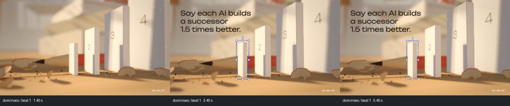
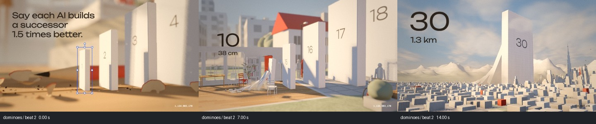
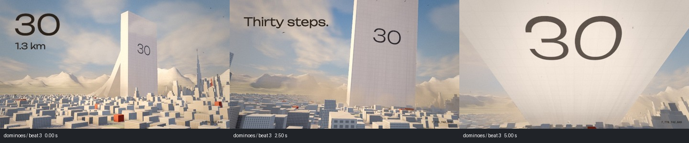

# 06 · 让尺寸增长同时改变画面尺度与落音

原场景 **Thirty steps** · 标识 `dominoes` · 3 拍。

## 画面是怎样搭起来的

骨牌复用几何体，以实例属性 iNum 标记序号；数字标记取自纹理。另有 2048×2048 深度目标，主场景使用透视相机和深度缓冲。远景在尺度剧烈变化时仍需要邻近物体作参照。

## 动作怎样推进

连续倒下的 14 秒内，按跨过的骨牌序号播放落音。序号 15～24 叠加 thud，25 起叠加 boom，29 加入 creak。代码还要求序号前进且单次变化小于 3，避免大跳转补放大量落音。

## 复刻时怎样检查

先只画轮廓和地面。若观众看不出尺寸在增大，加入城市或固定参照物，再加纹理。拖到后半段时检查较重的附加落音是否跟随本次跨过的序号。

在公开发布包中先搜索场景标识 `id:"dominoes"`，场景内部可用这些词定位：`iNum`、`tBig`、`domino`、`thud`。

## 逐拍取样

每行图从左至右是配置延迟结束、动画中点、动画终点。底部时间从本拍进入时起算；这些是定位渲染，现场讲者可以继续停留。

### 第 1 拍

交代相邻骨牌固定的尺寸比。

延迟 1.4 秒 · 动画 4 秒 · 自动停留 3 秒。

### 第 2 拍

让连续倒下的骨牌穿越多个尺度。

延迟 0 秒 · 动画 14 秒 · 自动停留 4 秒。

### 第 3 拍

停在末端，回扣每步使用同一个比例。

延迟 0 秒 · 动画 5 秒 · 自动停留 1.2 秒。

[返回逐场目录](README.md) · [机器可读场景地图](../evidence/deck-map.json)
