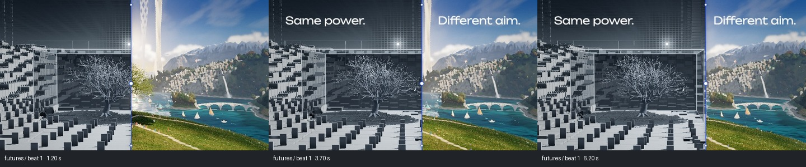
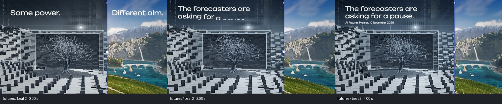
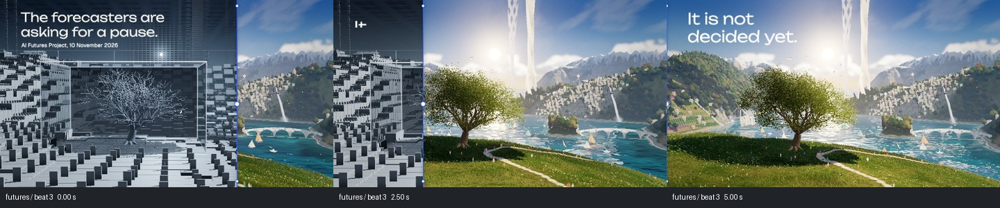

# 11 · 让分割线真正揭开同一视点的两种结果

原场景 **Two aims** · 标识 `futures` · 3 拍。

## 画面是怎样搭起来的

两套透视相机共享 34° 视场与相同裁剪范围。把归一化分隔位置换成整数像素列，按左右范围绘制两个世界，两侧标题也裁剪到各自范围。共同说明最后叠加。

## 动作怎样推进

按下时只有命中分界附近才开始拖动，并存下抓取点与分界线的偏移。移动时把横坐标扣除偏移、换算成舞台比例并限制范围；拖动状态由场景接管。

## 复刻时怎样检查

按住分界线边缘开始拖动，线条不应跳到指针中心。拖到边界时，一侧宽度变为零，对应区域和标题都应消失；松开时不翻页。

在公开发布包中先搜索场景标识 `id:"futures"`，场景内部可用这些词定位：`ew-resize`、`scissorTest`、`Same power.`。

## 逐拍取样

每行图从左至右是配置延迟结束、动画中点、动画终点。底部时间从本拍进入时起算；这些是定位渲染，现场讲者可以继续停留。

### 第 1 拍

在同一海湾拖动分隔线，对照两种结果。

延迟 1.2 秒 · 动画 5 秒 · 自动停留 6 秒。

### 第 2 拍

显示作品引用的暂停呼吁。

延迟 0 秒 · 动画 4 秒 · 自动停留 5 秒。

### 第 3 拍

停下来，允许讲者拖回另一侧回应提问。

延迟 0 秒 · 动画 5 秒 · 自动停留 8 秒。

[返回逐场目录](README.md) · [机器可读场景地图](../evidence/deck-map.json)
