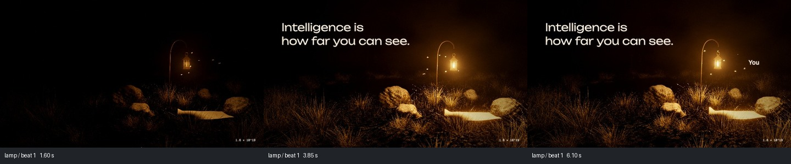
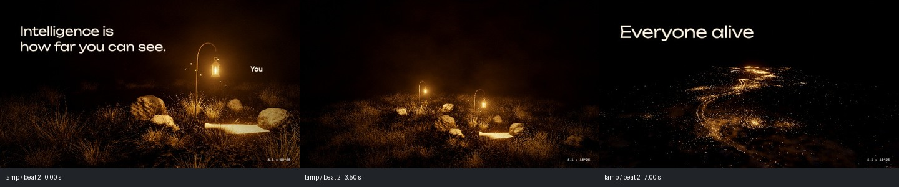

# 08 · 让灯的位置决定标签的位置

原场景 **How far you can see** · 标识 `lamp` · 3 拍。

## 画面是怎样搭起来的

三维坐标先经透视相机投影，再映射到舞台坐标定位标签。相机视场 60°，近裁剪面 0.001，远端 4000；近灯、远场与日出分别保留状态。

## 动作怎样推进

第一拍在动画时间 0.2 秒触发 shimmer，3.1 秒触发 bell；第三拍在 0.05 秒加低频，0.6 秒起势，7 秒时钟声叠低频。后者与最后一个标题在 7～9.4 秒间逐字去模糊相呼应。

## 复刻时怎样检查

移动相机，标签应该继续靠近对应光源。只靠整体调亮会丢失暗区，先让观众看见灯只能照亮局部，再引入日出。

在公开发布包中先搜索场景标识 `id:"lamp"`，场景内部可用这些词定位：`Superintelligence`、`shimmer`、`bell`、`uCam`。

## 逐拍取样

每行图从左至右是配置延迟结束、动画中点、动画终点。底部时间从本拍进入时起算；这些是定位渲染，现场讲者可以继续停留。

### 第 1 拍

在黑暗中点亮一个人的灯。

延迟 1.6 秒 · 动画 4.5 秒 · 自动停留 3 秒。

### 第 2 拍

扩大到更亮的灯和许多盏灯，保留未照亮的场域。

延迟 0 秒 · 动画 7 秒 · 自动停留 4 秒。

### 第 3 拍

用日出揭示此前看不见的空间。

延迟 0 秒 · 动画 11 秒 · 自动停留 8 秒。

[返回逐场目录](README.md) · [机器可读场景地图](../evidence/deck-map.json)
