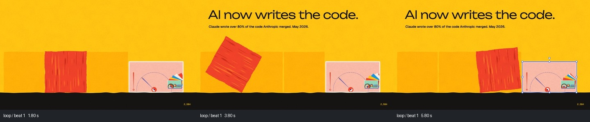
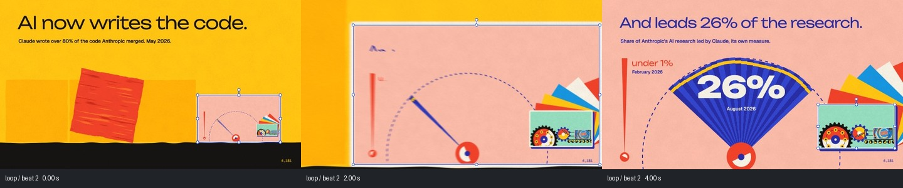
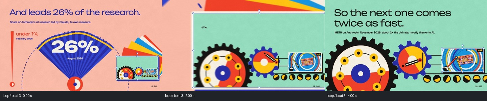
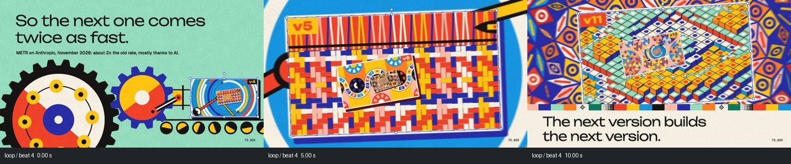

# 04 · 让递归看起来可以无限继续

原场景 **The loop** · 标识 `loop` · 4 拍。

## 画面是怎样搭起来的

场景用着色平面绘制图形层，逐层传递子图范围、像素大小和平均色。版本标签来自小型字形图集；字符集只有 v 和数字，单字符单元宽 192、高 256。标签在投影尺寸足够大时才显示。

## 动作怎样推进

第二、三拍分别给连续层级坐标累加一次缓动推进；第四拍根据本拍已过时间计算继续深入的量。后退时逐渐收回额外深度，帧间速度有上下限。

## 复刻时怎样检查

挑一处子图边界作为对齐点，比较放大前后相同图形在边界两侧的位置。缩得过小时隐藏标签，可避免远处层级形成闪烁文字。

在公开发布包中先搜索场景标识 `id:"loop"`，场景内部可用这些词定位：`uChild`、`uMean`、`v0123456789`。

## 逐拍取样

每行图从左至右是配置延迟结束、动画中点、动画终点。底部时间从本拍进入时起算；这些是定位渲染，现场讲者可以继续停留。

### 第 1 拍

先介绍代码生产的占比。

延迟 1.8 秒 · 动画 4 秒 · 自动停留 4 秒。

### 第 2 拍

用扇叶把比例变化画出来。

延迟 0 秒 · 动画 4 秒 · 自动停留 5 秒。

### 第 3 拍

用两只转速不同的轮子比较速度。

延迟 0 秒 · 动画 4 秒 · 自动停留 5 秒。

### 第 4 拍

把上一轮输出嵌进下一轮，让观众看到反馈。

延迟 0 秒 · 动画 10 秒 · 自动停留 7 秒。

[返回逐场目录](README.md) · [机器可读场景地图](../evidence/deck-map.json)
