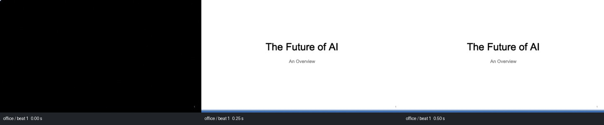
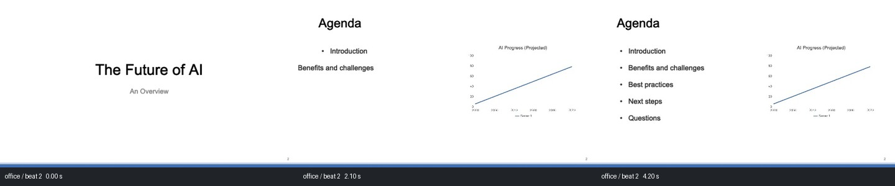
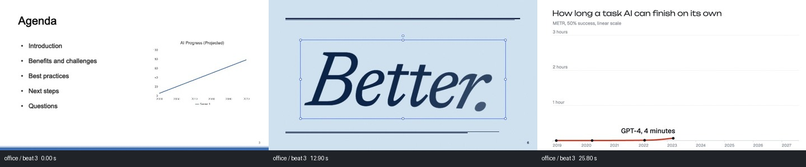

# 01 · 让幻灯片当着观众的面改写自己

原场景 **The Future of AI** · 标识 `office` · 3 拍。

## 画面是怎样搭起来的

舞台用两套独立的白底叠层绘制标题和议程。以设计坐标计，主标题中心在 (960,450)，字号 96；副标题位于 (960,590)，字号 44。议程改为左对齐，条目起点 y=330，行距 108。图表是独立纹理，选择框也有自己的叠层，所以它们可以先后出现。

## 动作怎样推进

第三拍把时间交给程序。到 1.9 秒开始擦除 Agenda，2.5 秒起逐字写第一句，7.4 秒起再次删除，8 秒开始输入下一句。选择框、光标和打字声都跟随文本状态；页码在这一拍内允许继续变化。

## 复刻时怎样检查

先复刻普通版式，再做自动编辑：截取同一拍的 0 秒、3 秒和 8.5 秒，应该读到不同的编辑状态。若只在按键时整页替换，观众会错过“幻灯片开始自己工作”的转折。

在公开发布包中先搜索场景标识 `id:"office"`，场景内部可用这些词定位：`The Future of AI`、`Agenda`、`This slide is bad.`。

## 逐拍取样

每行图从左至右是配置延迟结束、动画中点、动画终点。底部时间从本拍进入时起算；这些是定位渲染，现场讲者可以继续停留。

### 第 1 拍

用常规白底标题页开场，让观众习惯平淡的版式。

延迟 0 秒 · 动画 0.5 秒 · 自动停留 4 秒。

### 第 2 拍

按普通议程读出条目，让图表出现在观众视野里。

延迟 0 秒 · 动画 4.2 秒 · 自动停留 3.5 秒。

### 第 3 拍

讲者停下来，让演示自行改写版式，等图表重新成为焦点。

延迟 0 秒 · 动画 25.8 秒 · 自动停留 1.5 秒。

[返回逐场目录](README.md) · [机器可读场景地图](../evidence/deck-map.json)
