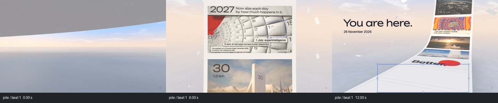
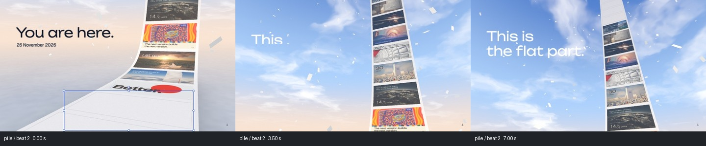

# 12 · 把先前看过的画面变成墙上的实体

原场景 **You are here** · 标识 `pile` · 2 拍。

## 画面是怎样搭起来的

每个页面网格优先取此前离场时保存的场景快照。若讲者从目录直接跳到这里，程序先放一张 1×1 占位纹理，再加载对应的 thumb 图。场景入口还会从设备日期生成当日文字。

## 动作怎样推进

镜头在第一拍约 1.6～10.6 秒沿页面排列路径返回底部，8.6～12 秒间过渡到终点观察姿态。入场与离场都把指定页面的四角投影给 portal 合成器。

## 复刻时怎样检查

分别测试完整播放到此处和直接跳入。如果后者出现大片空白，检查缩略图回退路径；两种路线可以使用不同来源的墙面图像。

在公开发布包中先搜索场景标识 `id:"pile"`，场景内部可用这些词定位：`snapshots`、`thumb-`、`portal`、`getFullYear`。

## 逐拍取样

每行图从左至右是配置延迟结束、动画中点、动画终点。底部时间从本拍进入时起算；这些是定位渲染，现场讲者可以继续停留。

### 第 1 拍

沿此前建立的尺度返回现在，等镜头停稳。

延迟 0 秒 · 动画 12 秒 · 自动停留 3 秒。

### 第 2 拍

从底部抬头看由先前画面组成的高墙。

延迟 0 秒 · 动画 7 秒 · 自动停留 5 秒。

[返回逐场目录](README.md) · [机器可读场景地图](../evidence/deck-map.json)
