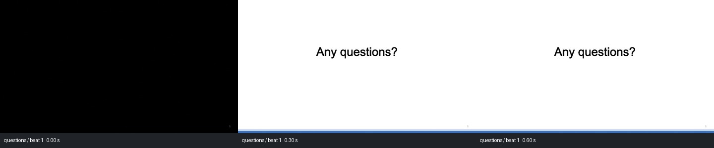
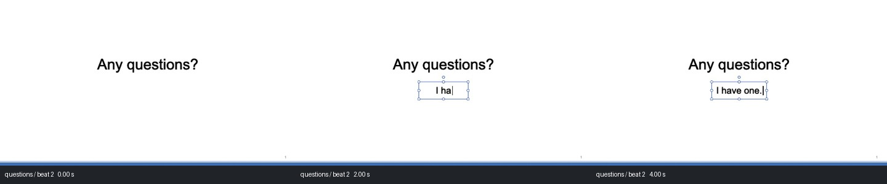
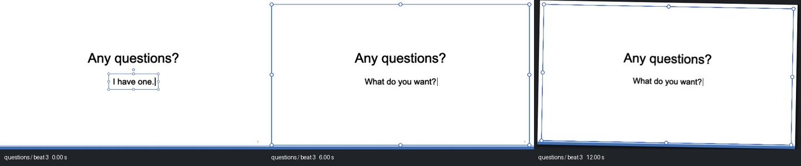

# 13 · 把“提问结束”变成最后一个编辑动作

原场景 **Any questions?** · 标识 `questions` · 3 拍。

## 画面是怎样搭起来的

复用白底、蓝线和开场的字号体系，问题、副行、输入光标与选择框分别绘制。第三拍先擦除上一句，再输入最后一个问题；选择框由文字宽度扩展到四周留边的整个画面。

## 动作怎样推进

第二拍从 1.5 秒开始约每秒 9 字符输入；第三拍以每秒 22 字符擦除，在 1.5 秒后以每秒 11 字符输入新句。等输入结束再启动选框扩张，随后整页朝负方向倾斜约一度并缩小约 3.5%。

## 复刻时怎样检查

先检查刚输入第一字、全文完成和最后静止三个状态。旋转时一起处理页面与选框，否则最后一度的回扣会显得像选框错位。

在公开发布包中先搜索场景标识 `id:"questions"`，场景内部可用这些词定位：`What do you want?`、`ang`、`tilt`、`getContext`。

## 逐拍取样

每行图从左至右是配置延迟结束、动画中点、动画终点。底部时间从本拍进入时起算；这些是定位渲染，现场讲者可以继续停留。

### 第 1 拍

回到白底提问页，制造结束感。

延迟 0 秒 · 动画 0.6 秒 · 自动停留 4 秒。

### 第 2 拍

讲者再按一次，把注意力交给屏幕。

延迟 0 秒 · 动画 4 秒 · 自动停留 2.5 秒。

### 第 3 拍

保留最后的问题，并以一度倾斜回扣靶心。

延迟 0 秒 · 动画 12 秒 · 自动停留 8 秒。

[返回逐场目录](README.md) · [机器可读场景地图](../evidence/deck-map.json)
