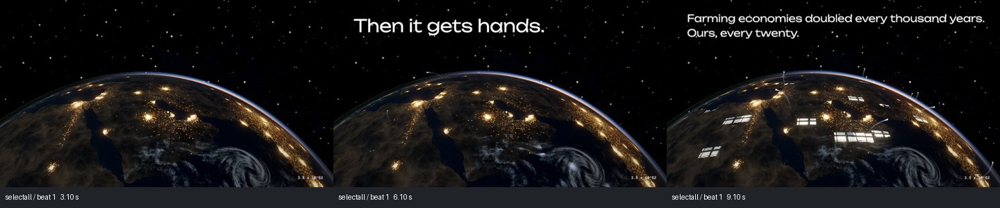
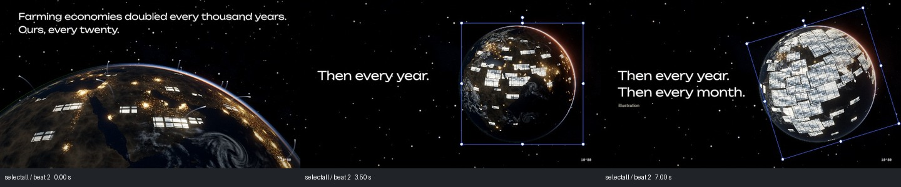
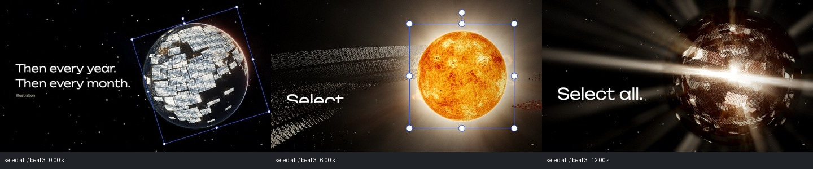

# 09 · 把熟悉的选择框放大到天体尺度

原场景 **Select all** · 标识 `selectall` · 3 拍。

## 画面是怎样搭起来的

先画背景，按状态绘制太阳及其光束、地球，再后处理并叠加文字与选择框。选择框有独立控制柄和线宽；其大小、透明度可以独立于行星表面变化。

## 动作怎样推进

第一部分交代物理产能，下一拍压缩倍增周期，最后一拍扩大选择范围。第三拍约 8.2～9.6 秒淡出选框；随后仍有场景事件，11.2 秒触发低音高的 boom。

## 复刻时怎样检查

让观众先能辨认编辑器式的角控制柄，再扩大被选的范围。画面亮度升高时单独检查选框可见性，保留对情景推演的说明。

在公开发布包中先搜索场景标识 `id:"selectall"`，场景内部可用这些词定位：`showEarth`、`showSun`、`Select all.`、`uLine`。

## 逐拍取样

每行图从左至右是配置延迟结束、动画中点、动画终点。底部时间从本拍进入时起算；这些是定位渲染，现场讲者可以继续停留。

### 第 1 拍

把屏幕内的编辑动作引向实体机器。

延迟 3.1 秒 · 动画 6 秒 · 自动停留 3 秒。

### 第 2 拍

用缩短的倍增周期演示作品的假设。

延迟 0 秒 · 动画 7 秒 · 自动停留 2.5 秒。

### 第 3 拍

将选择框的目标扩大到地球。

延迟 0 秒 · 动画 12 秒 · 自动停留 6 秒。

[返回逐场目录](README.md) · [机器可读场景地图](../evidence/deck-map.json)
