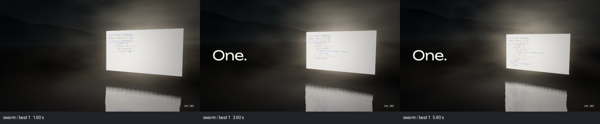
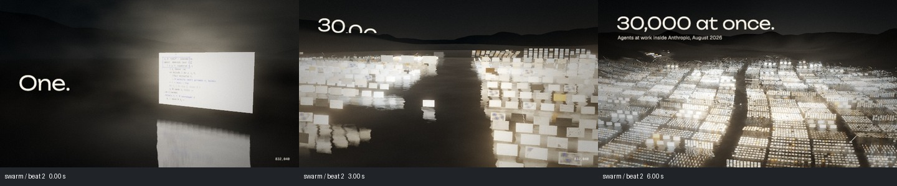
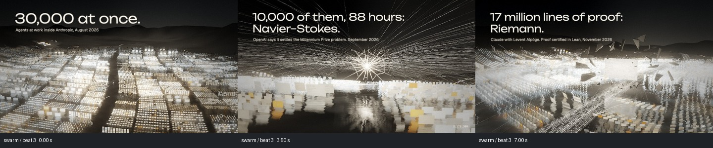
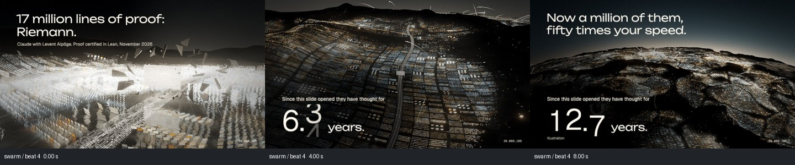

# 05 · 从一个工作者拉到一片并行活动

原场景 **A country of them** · 标识 `swarm` · 4 拍。

## 画面是怎样搭起来的

文字叠层与三维场景分开。主目标使用四重采样，反射使用半分辨率目标；相机视场约 34°。场景通过地图和噪声纹理驱动大规模细节，亮灯范围、雾、太阳和核心亮度分别进入着色参数。

## 动作怎样推进

第二拍的尺度参数分段做对数插值，目标依次经过 3.2、15、55、140、300。末拍的计数使用本拍经过时间；进入场景时重设基准，避免从目录跳入后出现继承的计数。

## 复刻时怎样检查

先让一个个体在近景中可辨，再验证大幅拉开时亮点能否汇成群体。计数持续变化时，讲者应能停留解释，而无需连续点击。

在公开发布包中先搜索场景标识 `id:"swarm"`，场景内部可用这些词定位：`uOnBand`、`uCore`、`uFog`、`30,000 at once.`。

## 逐拍取样

每行图从左至右是配置延迟结束、动画中点、动画终点。底部时间从本拍进入时起算；这些是定位渲染，现场讲者可以继续停留。

### 第 1 拍

从单个工作者开始。

延迟 1.6 秒 · 动画 4 秒 · 自动停留 3 秒。

### 第 2 拍

拉开规模，看大量个体同时工作。

延迟 0 秒 · 动画 6 秒 · 自动停留 4 秒。

### 第 3 拍

切入作品讲述的协作成果，留时间解释。

延迟 0 秒 · 动画 7 秒 · 自动停留 4 秒。

### 第 4 拍

让计数器继续走，讲清这里使用的是假设。

延迟 0 秒 · 动画 8 秒 · 自动停留 8 秒。

[返回逐场目录](README.md) · [机器可读场景地图](../evidence/deck-map.json)
