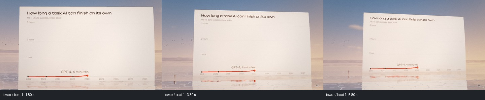
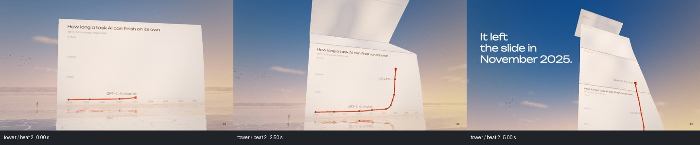
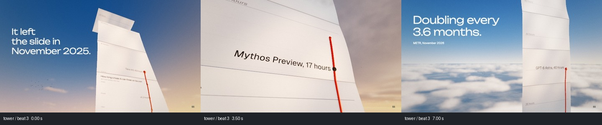
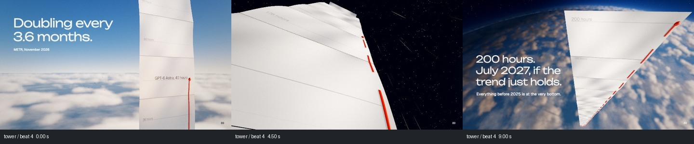

# 02 · 把二维图表的边界接到三维墙面

原场景 **The real chart** · 标识 `tower` · 4 拍。

## 画面是怎样搭起来的

底图通过 Canvas 2D 绘入 2560×1440 画布；初始化时关闭曲线和标签，让后续图形可以分层出现。透视相机初始参数含 35° 视场、0.4 到 30000 的裁剪范围。主场景保留深度与多重采样，另设半分辨率缓冲，天空、雾和塔身共享相机参数。

## 动作怎样推进

入场先把图表四个角设为屏幕四角。之后逐帧把塔面四角投影回屏幕，供 portal.in 合成器使用；透明度随入场进度衰减。图表在衔接点保留可辨认的边缘，视点才有机会从读图转换成仰望。

## 复刻时怎样检查

固定首尾相机，先验证四个角是否对齐，再接升高路径。最后一拍应能区分已画出的观测段和虚线外推，并能回望起点。

在公开发布包中先搜索场景标识 `id:"tower"`，场景内部可用这些词定位：`uAlt`、`uMist`、`portal.in`、`curve:!1`。

## 逐拍取样

每行图从左至右是配置延迟结束、动画中点、动画终点。底部时间从本拍进入时起算；这些是定位渲染，现场讲者可以继续停留。

### 第 1 拍

在同一线性刻度上看早期数据挤在底部。

延迟 1.8 秒 · 动画 4 秒 · 自动停留 4 秒。

### 第 2 拍

视点沿图表升高，增长线冲出普通页边。

延迟 0 秒 · 动画 5 秒 · 自动停留 4 秒。

### 第 3 拍

让观众感受高处的尺度，同时交代估计范围。

延迟 0 秒 · 动画 7 秒 · 自动停留 4 秒。

### 第 4 拍

往下看；讲清虚线段是趋势外推。

延迟 0 秒 · 动画 9 秒 · 自动停留 6 秒。

[返回逐场目录](README.md) · [机器可读场景地图](../evidence/deck-map.json)
