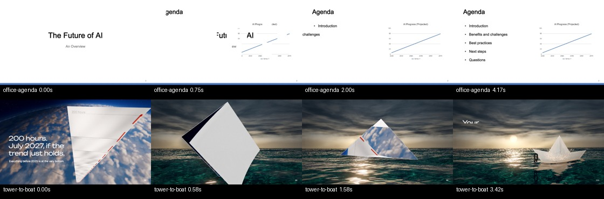

# 一个按键，怎样驱动整场演示

读作品结构时，先打开场景地图。按每条记录的 id 对照截图，用 beats 中的中文动作摘要读懂这一拍想让观众看到什么。排时间时读取 delay_s、animation_s 和 auto_hold_s；跨场另查 transition_duration_s。全部时间单位为秒。作品提出的预测属于演讲内容。[13 场、43 拍的场景地图](evidence/deck-map.json)

## 1. 播放器同时维护每一拍的进度

公开包中的场景实例保存当前拍号、每拍独立的进度数组和经过时间。以高塔第一拍为例：配置给出 1.8 秒延迟、4 秒动画和 4 秒自动停留。每帧先累加经过时间，过了延迟才推进动画。手动演讲时，动画到终点后仍可停在这里；自动模式则在三段配置时间之和超过阈值后请求下一拍。

|操作|运行时行为|对现场演讲的影响|
|---|---|---|
|同场下一拍|当前拍以正常速度推进，尚未完成的早先各拍以 3 倍速度补到终点|讲者提前按键时，前一动作仍能收尾|
|同场退一拍|高于当前拍号的进度按正常速度的 2.4 倍衰减到零|上一层内容逐渐退场|
|退回上一场|前一场恢复到末拍，原转场反向播放，时长为正向的 55%|回看时仍看得出空间关系|
|转场中再按前进|当前转场提速到 3.5 倍，完成后消费一个待推进标志|连按时最多保留一次待推进|
|跳到指定场景|跨场跳转使用 fade；同场定位重设状态并将更早各拍标为完成|目录跳转与顺序播放可以展示不同的入场效果|

代码定位：在公开包中查找 `setAuto`、`_since`、`advance()` 和 `reverse`。每场的 `update` 接收进度，`render` 负责画面；在转场期间，出场和入场的场景都继续更新。直接启动时首页立即进入，场景配置里的 fade 不会凭空多占一段开场时间。

## 2. 前后场景先各画一遍，再合成为一帧

播放器将前场和后场分别写到两张离屏纹理 A、B，再把两张纹理、归一化进度和场景状态传给转场。合成画面之后才绘制页码，转场过半时页码取目标场景。普通帧只需绘制当前场景。表中的时长是正向完整播放的配置值。

|转场标识|秒|画面如何构造|
|---|---:|---|
|fade|0.7|用 smoothstep 修饰进度，再按该权重混合 A 和 B|
|portal-in|3.2|查询目标场景的 portal.in，取得用于投影的四角及透明度；有默认四边形路径|
|portal-out|2.8|查询出场场景的 portal.out，互换底图和投影图的角色|
|fold|3.4|沿多条折痕转动面片，将纸面与近、远两层阴影合到海面背景|
|wash|2.6|着色器按像素计算与波前的相对位置，推进覆盖边界|
|flaps|2.6|每格按对角线位置和固定哈希错开启动，分两或三次翻片，末次翻转用 0.34 秒|
|slam|1.9|把冲击位置、震动、旋转、缩放、尘埃和环形效果作为合成参数|
|daybreak|3.4|在多张半分辨率缓冲上处理亮度和曝光，再用于过渡|
|line|2.4|两侧画面各经过 1280×160、1280×20、1280×2 的缓冲，把二维图像压成细带|
|tear|2.8|独立绘制碎片，再取近、远阴影遮罩，与目标画面合成|

**折纸的具体时序。** 第一组折痕在 0.80～1.16 秒运动，另一侧稍晚，于 0.90～1.26 秒跟上。顶部与底部折痕延续到约 1.64 秒。随后切换顶点运动阶段，在 2.50～3.00 秒用衰减振荡让末段动作落稳。折痕错峰、纸张遮挡和阴影一起帮助观众在图表消失后继续追踪同一张纸。源码内可搜索 `portal.in`、`tileStart`、`uShake` 或转场注册表；折纸时长变量在这一版为 `Kb`。[折纸动态样片](evidence/tower-to-boat.mp4)

## 3. 同一支鼠标怎样区分拖动、点按和翻页

按下时播放器把指针坐标换算到舞台坐标，先交给场景的 pointer 处理。场景接管时，舞台捕获该指针；抬起后结束交互，跳过通用翻页。海湾对照因而可以拖动分隔线。若场景没有接管，水平位移超过 50 个 CSS 像素且大于垂直位移才按方向翻页；两个方向都移动不足 12 像素、历时不足 600 毫秒则按点击推进。坐标与画布渲染分辨率分开计算，调整画质不会改变手势阈值。代码定位：`setPointerCapture`、`pointerup`。

## 4. 声音跟随事件与场景状态

|触发点|声音行为|复现时要保留的关系|
|---|---|---|
|文本在正向更新中改变长度|触发 type，代码中该调用增益为 0.8|按字符变化触发，画面停住后应安静|
|骨牌索引跨过下一个整数|遍历刚跨过的序号并逐个触发 domino，增益从约 0.35 随序号增长|一帧跨过多块也能处理各次落音|
|纸船释放锚链|同一事件同时触发 snap 和 whoosh，后者带音高调整|短促断裂和后续运动共用触发点|
|海面场景入场进度接近完成|跨过 0.94 附近的门槛后触发一次 wave|用锁存状态避免每帧重复发声|

持续环境音另有 wind、water、hum 等分组。例如 water 组合棕噪声、粉噪声和嘶声，并分别滤波、定位。用户手势负责解锁浏览器音频。这些是代码内的音源与触发证据，两段动态取样均无音轨。代码定位：`AudioContext`、`bedBus`、`sfx("domino"`。

## 5. 演讲现场的渲染预算

常规播放用 requestAnimationFrame 驱动，将一次模拟步长限制在 0.05 秒。显示像素比默认最多取 2，再按 2560×1600 的总像素预算缩放。内部分辨率有 1、0.84、0.70、0.58 四档。程序参考平滑帧耗时降档（阈值 21 毫秒），回升需要更长的稳定窗口。headless 取样关闭了这套自适应逻辑，因此样片不能用于估算现场帧率。

预热会静音试绘各拍，并在进度 0.2、0.5、0.8 试绘场景的入场转场。切换时另存 640×360 场景快照；离当前场较远的资源可进入停用状态。阅读入口为 `warmAll`、`snapshots` 和 `requestAnimationFrame`。

## 6. 用动态像素复查两种不同的动作

|样片|实际取样|rea-video 的结果|对照画面与代码|
|---|---|---|---|
|[开场第二拍](evidence/office-agenda.mp4)|51 帧，12 fps，4.25 秒|检出一个动态段；代码渲染类别得分 0.8972|0.00 秒是标题页，0.75 秒可见旧标题与新元素交叠，2.00 秒议程正在出现，4.17 秒列表完整。一个演讲节拍内有多次视觉变化|
|[高塔到纸船](evidence/tower-to-boat.mp4)|42 帧，12 fps，3.50 秒，包含转场终点|约 0.583 秒出现检测边界，两段最高分类均为实拍，得分约 0.44、0.40|此时白色纸面已占据视野，海面背景已经出现。运行时始终在同一个 fold 合成器中推进；工具给出的边界反映画面显著变化|

两段都由本地发布版的 headless 定位接口逐帧取样，以固定 12 fps 编码，无录音。采样覆盖末帧，所以容器时长与动画配置时长略有差别。第一段对每帧调用 `test.seek("office", 1, 时间秒)`；第二段调用 `test.trans("boat", 归一化进度)`。这些端点用于重建指定时刻，观众在现场的点击间隔和设备掉帧不在样本内。rea-video 的命令与首页一致，把输入替换成相应 MP4；未启用 VLM。每个样片的 SHA-256、媒体参数和逐段分类得分均可复查。[检测结果](evidence/motion-analysis.json) · [公开作品](https://claude.ai/artifact/Cy2d8Vn63CnzCtonA1LSah)
